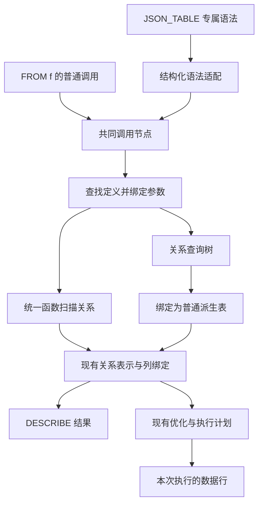

# seekdb 表函数框架与虚拟表迁移设计

更新日期：2026-10-17。状态：Q1–Q23 及后续六项架构复核修订均已确认，实现与本地验收完成。本文记录设计契约；实际测试范围、基线问题及当前 PL 语言边界见[实施任务图](../implementation/table-functions.md)和[验证记录](../implementation/table-functions-validation.md)。

## 1. 目标与边界

建立共同的内建表函数框架，让函数提供参数约定、输出列和数据来源，接入现有查询体系。框架集中负责查找定义、绑定参数与输出列、接入现有关系表示、驱动扫描生命周期。现有虚拟表的查询能力通过独立命名的内建表函数提供，使虚拟表自身不再成为持久化 schema 对象；逐项核对能力去向，允许语义相同的入口合并，不要求函数数目与旧 VT 数目相等。

| 事项 | 已确认的范围 |
| --- | --- |
| 函数入口 | `FROM f(...)`；移除通用 `TABLE(...)` 包装 |
| 名称 | 全局名称，不添加 `seekdb_` 产品前缀；例如 `memory_info()` |
| 提供方式 | 本轮只建设内建表函数，随程序发布和注册 |
| 普通函数 | 继续返回一个值；集合值通过 `UNNEST(...)` 进入 FROM |
| 用户创建表函数 | 本轮不新增；现有 `CREATE FUNCTION` 的存储函数对象另行管理 |
| 兼容与部署 | 无旧接口兼容要求；分阶段开发，交付时整体切换，以新实例验收 |
| 消除对象 | 虚拟表自身的表、索引 schema 及相应持久化元数据 |
| 保留对象 | 系统视图、真实系统基表、本地系统存储、用户对象及其持久化 |
| 输出推导 | 注册定义、元素声明或显式参数；本轮不扫描实际数据猜测列 |
| 授权 | 内建函数声明权限要求，复用已有权限和结果可见性检查；不新增逐函数 GRANT |
| 首版优化 | 实现投影和迁移必需的定位条件，SQL 层保留过滤复核；复用已有对象依赖与缓存机制 |
| 配套能力 | PL 复合值的客户端编码由通用结果输出层实现，表函数交付有类型的列值 |

内建函数需要必要的注册信息和列描述内存。“不占 schema 对象”不表示函数没有输出列定义，也不表示它查询的数据只能来自内存。

## 2. SQL 入口与职责

```sql
SELECT * FROM memory_info();
SELECT * FROM generator(3);
SELECT * FROM UNNEST([1, 2]);
SELECT * FROM UNNEST(get_user_list());

SHOW TABLE FUNCTIONS;
DESCRIBE TABLE FUNCTION memory_info;
DESCRIBE TABLE FUNCTION unnest;
DESCRIBE TABLE FUNCTION unnest([1, 2]);
```

`get_user_list()` 是示意性的普通集合值函数，不是内建表函数。`FROM f(...)` 只在表函数注册表查找；普通表达式中的 `f(...)` 只按普通函数规则查找。允许两类同名，查找失败时不跨类别兜底，不自动将普通函数返回值转成行。

名称比较、参数匹配和隐式转换尽量复用现有 SQL 函数机制；多个签名无法唯一匹配时应报告歧义。全局函数身份不依赖当前数据库中的同名表对象。

`JSON_TABLE` 保留路径、`COLUMNS`、嵌套列等专属语法，解析后转换为带结构化选项的共同调用节点。适配过程保存语义信息，不靠拼装另一条 SQL 来代替 JSON_TABLE 的语法解析。未提供 COLUMNS 的自动探测 JSON 能力不在本轮范围内。

本轮统一 FROM 中的数据来源，不新增 DuckDB 式 SELECT 位置行展开等另一套表达式语法。VALUES 继续作为关系构造语法存在。

## 3. 输出列与 SELECT metadata

### 3.1 列名的来源和顺序

| 函数或输入 | 默认列名来源 |
| --- | --- |
| 系统信息函数 | 函数定义中的有序固定列；迁移时从现有定义提取 |
| JSON_TABLE | COLUMNS 中声明的名字与语义顺序 |
| GENERATOR | 一列 `generator` |
| 单个非记录集合的 UNNEST | 一列 `unnest`，非记录也包括内层集合值 |
| 多输入 UNNEST 中的非记录元素 | `unnest_1`、`unnest_2` 等，后缀为从 1 开始的输入参数位置 |
| UNNEST 的记录元素 | 记录声明的顶层成员名与成员顺序 |
| 查询展开型函数 | 展开后的查询绑定得到的有序输出列 |

多输入 UNNEST 按输入顺序拼接各自的输出列。默认名字不随数组内容、来源列名或表达式文本变化。除本设计明确调整的规则外，迁移保留现有功能的列名和参数语义。GENERATOR 的新默认列名为 `generator`，其 `n` 是执行时参数，具体约定见 5.3 节；旧 `COLUMN_VALUE` 名称和常量限定不再作为交付契约。

共同绑定流程负责按位置应用列别名：`AS t` 只改关系引用名，`AS t(a, b)` 改前两列，允许只指定前若干列；别名数超过输出列数报错。应用别名后，同一个调用内的输出列名必须唯一，重名时报错，不自动改写记录成员名或显式别名。列名比较沿用 SQL 标识符规则。

函数定义必须提供合法的列名；注册或绑定得到无效列定义应明确报错，不以执行第一行数据补齐定义。

### 3.2 最终结果列名

输出列描述进入本次查询的列绑定，SELECT * 按顺序展开；显式 SELECT 投影和 SELECT 别名最终决定发给客户端的列标签。

```sql
SELECT t.x AS value
FROM UNNEST([1, 2]) AS t(x);
```

上例中默认列名为 `unnest`，调用处列名为 `x`，SELECT 结果标签为 `value`。表函数输出列唯一性规则不禁止外层 SELECT 产生重复结果标签，也不禁止不同来源各自包含同名列。

沿用现有结果集填充机制时，`ObField.cname_` 取 SELECT 最终标签，直接列引用的 `org_cname_` 来自绑定列名；不得为补充来源信息而重新构造虚拟表 schema。结果元数据与行编码必须使用相同的最终列顺序和列数，尤其不能在协议输出阶段把约定保留为一列的内部记录偷偷拆成多个字段。

### 3.3 发现与描述

| 命令 | 单个普通结果集的结构 |
| --- | --- |
| SHOW TABLE FUNCTIONS | 每个签名一行：`function_name`、`signature`、`description` |
| DESCRIBE TABLE FUNCTION name | `signature`、`column_position`、`column_name`、`column_type`、`description`；固定输出每列一行，同名重载按签名分组 |
| DESCRIBE TABLE FUNCTION call | 绑定具体调用后，以同样的列信息格式返回；可附与 FROM 相同的列别名 |

按名称描述动态输出时，每个相关签名返回一行规则说明，三个列信息字段为 NULL，不虚构具体列。按调用描述若参数不足、引用缺少绑定上下文或输出仍有重名，则返回正常绑定错误。

描述 `UNNEST(get_user_list())` 时读取函数返回声明和元素声明，不调用函数取样。固定输出的描述直接读取注册定义；动态输出的调用描述复用查询绑定逻辑。SHOW/DESCRIBE 不执行扫描，不为承载自己的结果新增虚拟表；需要目标对象信息时可以访问相应元数据。

定义目录展示随程序发布的名称、签名和说明。真正的数据访问另行检查调用权限及结果可见性。

### 3.4 PL 复合列的客户端表示

表函数交付有类型的列值；SQL 内部的记录和集合继续支持字段投影和 UNNEST。最终向 MySQL 客户端输出时，PL 复合值编码为单个 JSON 文本单元格，列名和列数保持不变，整个列值为 NULL 时发送 SQL NULL。

此能力由通用结果输出层作为独立配套任务实现，同类型值无论来自 UNNEST、子查询还是其他表达式，都采用相同转换。表函数注册和扫描接口不承担 JSON 序列化，也不增加按函数选择的编码回调。具体表示、协议元数据和验收要求见 [PL 复合值客户端输出设计](./pl-composite-client-output.md)。

## 4. UNNEST 的行语义

UNNEST 将集合元素逐个变成结果行。记录元素直接构成一行，顶层成员成为列，成员中的集合或记录仍是列值；这是一层元素到行的映射，不递归拆解内部数据。该映射属于 UNNEST 自身的绑定与扫描语义，公共表函数框架不对其它函数执行通用记录展开。

| 输入情形 | 结果 |
| --- | --- |
| 空集合或 NULL 集合 | 零行 |
| 含一个 NULL 元素的集合 | 保留该元素对应的一行 |
| 嵌套集合 | 去掉外层集合，内层集合继续作为列值 |
| 记录集合 | 每个记录一行，成员名成为列名；NULL 记录元素对应保留的一行，成员值为 NULL |
| 多个集合 | 按遍历顺序逐个配对，行数取最长输入的元素数，耗尽输入对应的列补 NULL |

这里的 NULL 集合必须具有足以确定元素定义的信息；裸 NULL 或未知参数能否绑定，与运行时产生零行是两件事。

```sql
SELECT * FROM UNNEST([1, 2], ['a']) AS t(n, s);
-- (1, 'a'), (2, NULL)
```

两个记录输入如果都包含 `id`，默认列存在冲突，调用处需要提供列别名。记录成员恰好与生成名 `unnest_2` 等相同时，也采用相同规则。

行值参数可以引用 JOIN 左侧已引入的来源，不要求另写 LATERAL：

```sql
SELECT u.id, t.tag
FROM users AS u
CROSS JOIN UNNEST(u.tags) AS t(tag);

SELECT u.id, t.tag
FROM users AS u
LEFT JOIN UNNEST(u.tags) AS t(tag) ON TRUE;
```

第一条将每个用户与该用户的展开结果组合；第二条还保留没有展开结果的用户。关联作用域遵循正常 JOIN 绑定规则，不支持引用尚未引入的来源。

普通 PL 函数仍可能先构造整个集合，UNNEST 随后遍历它。共同的批次输出接口不改变 PL 函数的数据准备方式，也不代表所有系统信息扫描都逐行实时采样。

## 5. 框架接口与绑定流程

### 5.1 模块边界

以下是实现规格中的接口角色，名字用于表达职责，并非本轮新增的 C++ 类型。

| 接口角色 | 责任与主要信息 | 生命周期 |
| --- | --- | --- |
| `TableFunctionRegistry` | 按名称和签名查找不可变内建定义，供查询、SHOW、DESCRIBE 共用 | 程序启动时建立 |
| `TableFunctionDescriptor` | 名称、签名、参数阶段、说明、固定列或输出规则、绑定回调、权限及首版访问能力 | 注册定义 |
| `TableFunctionCall` | 参数表达式、结构化专属选项、关系/列别名和源位置 | 本次解析/绑定 |
| 现有关系表示 | 用现有 TableItem、派生表及对应计划承接输出列、别名、关联引用和查询语义 | 查询绑定/计划 |
| 扫描绑定信息 | 扫描实现、执行时参数及不可变的绑定数据，附着于扫描关系；不承载查询展开分支 | 查询绑定/计划 |
| `ITableFunctionScan` | 创建和使用扫描状态，初始化、取批次、重扫、关闭 | 本次执行 |
| 现有执行上下文 | 分配器、会话、取消状态，以及需要的数据源/真实 schema 访问能力 | 本次执行 |

绑定结束即接入现有关系表示：查询展开成为普通派生表，不再保留可执行的表函数包装；扫描实现形成统一的函数扫描关系。别名、列引用、权限、对象依赖和计划缓存复用现有查询机制，不新增贯穿优化与执行的双分支 BoundTableFunction 体系。

系统信息提供方通过注册和现有执行上下文接入数据访问；公共 binder 不直接逐个调用 observer 的扫描类，也不创建提供方的全局资源。JSON_TABLE 的 PATH、COLUMNS 等语义留在其语法适配和自身绑定实现中。通用结果输出层统一处理客户端编码，表函数框架只交付列值。

自身输出列只依赖轻量列描述。查询内仍可以分配局部关系 ID 和列位置；这些标识不进入持久化 table schema 或全局对象版本管理。内建函数身份与旧 VT ID 的映射可以用于迁移核对，不作为扫描时查询自身 schema 的依据。



### 5.2 共同绑定过程

1. 解析普通调用，或由专属语法适配产生共同调用及结构化选项。
2. 查找表函数签名，按 SQL 规则解析参数及其声明，检查可见的外部列引用。
3. 取得绑定时参数；执行时参数保留为表达式，只读取其静态信息。
4. 调用函数绑定逻辑。扫描路径提供扫描定义和输出列，形成统一函数扫描关系；查询展开路径提供关系表达式，经普通查询绑定后形成派生表。
5. 向现有查询依赖机制登记绑定过程读取的对象，并合并普通查询绑定取得的对象依赖；消费可变用户变量等情形设置通用的不可缓存标记。
6. 通过现有关系绑定统一应用列别名、检查列定义与重名、接入权限要求并注册查询局部列。
7. 交付现有关系表示。DESCRIBE 读取绑定后的列，后续优化处理普通派生表或函数扫描关系，不再按原函数名选择执行模式。执行状态在执行阶段才创建。

查询展开路径可以先适配 HYBRID_SEARCH 现有的 SQL 生成结果并解析为查询树，再进入普通绑定；通用框架不执行该 SQL。调用别名只对最终输出应用一次，避免展开前后重复改名。

### 5.3 参数阶段与预处理

| 参数阶段 | 能力和限制 |
| --- | --- |
| 绑定时参数 | 在计划生成前确定，可能决定列、目标关系或展开结构；允许字面量及安全的常量折叠，不执行 PL 用户函数或数据查询求值 |
| 直接查询的用户变量 | 可以成为绑定时配置；首版只要绑定过程读取可变用户变量，就将语句标记为不可缓存，不建设变量值追踪机制 |
| 执行时参数 | 提供数据值，可以是占位符、普通函数表达式或合法的关联列引用；绑定时须能确定输出契约 |
| 预处理语句的结构参数 | 初期限定为字面量或可安全折叠的常量，不通过 EXECUTE 的占位符或可变用户变量改变输出/展开结构 |

UNNEST 在绑定时读取元素声明，执行时取得集合值；JSON_TABLE 在绑定时读取 COLUMNS，执行时读取 JSON 文档。HYBRID_SEARCH 初期仍整体消费绑定时表名和配置，不因接入框架自动变成逐行接受搜索配置的接口。

GENERATOR 的 `n` 不影响输出列，属于执行时整数参数，可接受占位符、普通表达式及合法的关联列引用。每次调用初始化时求值一次，关联输入变化后重新求值并重置计数；正数产生 1 到 n，零和负数产生零行，NULL 报错，保留原有整数转换约定。开发中若仍有限定常量的阶段性实现，应记录为尚未完成的迁移项，不视为最终规则。

若元素定义或所需结构信息不足，明确报错并要求显式声明或固定结构；本轮不增加执行阶段重新发现输出列的机制。

## 6. 优化、执行、权限和缓存

### 6.1 访问能力

首版扫描接口接收所需投影和迁移必需的定位条件，例如库名、表名等值定位。函数声明能够使用的定位条件；由 WHERE 等查询过滤提取并下推的条件全部保留在 SQL 层复核，不提供“已完整满足、可以删除过滤”的处理状态。

投影包含 SELECT、连接及 SQL 复核过滤所需的列。定位只允许缩小到包含全部正确结果的范围；无法保证不漏行的条件不下推，SQL 复核不能补救错误裁剪。定位仍须遵守 NULL、类型转换、排序规则和外连接语义，不允许越过连接边界改变结果。

例如按库表名查询列信息时直接定位目标表；系统视图外层的条件也应能进入该接口。必须有定位输入才能执行的来源将其声明为必填参数，SHOW 等调用方显式传入，不依赖优化器恰好提取某个 WHERE 条件。

成本和行数估计采用框架能力及正常查询估计；函数可提供已知的估计，公共优化器不按具体函数名特判。查询展开路径继续使用普通关系计划的优化能力。定位能力不需要持久化的表或索引 schema。

通用谓词处理及基于等价性证明移除外层过滤属于后续优化，须有明确收益及验证证据，均不作为首版交付前提。

### 6.2 执行状态

每次执行拥有独立状态，包括迭代位置、连接、语句句柄、对象引用 guard 和采样缓存。原有逐行接口可以适配为批次；已有采集逻辑按其数据源特点复用。

关联调用在外层输入变化时按契约重扫或重建状态。记录的多个输出列共用一次元素求值，不因为有多个成员而重复调用普通集合函数。重扫是否复用本次已经物化的集合，遵循参数依赖及函数原有语义；状态不跨独立执行复用。

正常结束、提前停止、异常、取消和重扫都必须释放或正确转移相关资源。批次接口不强制所有提供方支持并行；并行能力必须由实现明确提供，不能默认共享非线程安全状态。

### 6.3 权限与依赖

内建函数声明调用所需的已有权限；对真实库表执行的结果可见性过滤继续保留。执行上下文提供相应会话和 schema 访问，不能因为函数自身没有表对象而绕过访问检查。

PL 集合函数的类型/存储函数依赖、真实表及索引版本复用现有对象依赖机制登记。绑定时查到的元数据与普通查询最终引用的对象取并集，防止只登记展开后 SQL 中可见的依赖。首版对绑定时消费可变用户变量采用不缓存策略，不另建通用配置依赖管理。

### 6.4 缓存

共享计划只持有不可变定义与完整依赖，不持有本次扫描的连接、游标或系统数据。重复执行系统信息函数读取本次数据；单次扫描内部的快照语义由具体实现定义。

依赖不完整、绑定时读取可变用户变量，或提供方尚不支持安全复用时，均通过现有查询/计划缓存机制的通用不可缓存标记阻止复用。HYBRID_SEARCH 初期由其绑定实现设置该标记，不在公共缓存逻辑中按函数名特判。首版不建设配置值追踪和失效通知体系；未来具备收益和完整依赖支持时再优化。

普通执行时参数可变化，但类型及输出契约必须满足已绑定要求；结构发生变化不能静默复用旧列或旧计划。禁止把执行时参数变化误当成必须禁用缓存的绑定时变量读取。

## 7. 现有入口和数据源的迁移

### 7.1 入口类别映射

| 现有入口 | 新入口 | 适配要点 |
| --- | --- | --- |
| TABLE(PL 集合表达式) | UNNEST(集合表达式) | 保留普通 PL 函数；接入元素声明、求值、遍历和一层记录映射 |
| TABLE(GENERATOR(n)) | GENERATOR(n) | 注册统一扫描，默认列名改为 generator，n 改为执行时参数；保留计数及 NULL/非正数语义，移除 TABLE 专属放行逻辑 |
| UNNEST | 同名注册函数 | SQL 数组与 PL 集合共用行/列契约，替换独立 resolver 分支 |
| JSON_TABLE | 同名专属语法适配 | 保留 PATH、COLUMNS、嵌套、序号、EXISTS、错误与空值策略 |
| HYBRID_SEARCH | 同名注册函数 | 绑定后成为普通派生表，保留结构参数限制；通过通用标记禁用缓存 |
| 每个虚拟表的查询能力 | 明确映射到内建表函数及必要的视图投影/筛选 | 初期可一一映射，核对语义后允许合并；输出定义从函数描述符取得 |
| 系统视图、SHOW、内部 SQL | 改为引用新函数 | 保留自身功能和可见性规则；系统视图自身仍是 schema 对象 |
| VALUES | 保持独立关系构造 | 不纳入函数注册表 |

本表覆盖入口类别。实施阶段生成逐 VT 的迁移清单，至少包括旧名称/ID、目标函数、必要的视图投影/筛选、输出定义、提供方、必填输入、权限、构建条件和内部消费者；对本次构建启用项检查能力无遗漏和名称冲突。`memory_info()` 是已采用的命名示例，`table_columns()` 等文中示例不代替逐项命名清单。

函数粒度按数据语义确定，不按旧 VT ID 个数确定。初期一一映射便于核对；只有查明入口语义相同或差异可以由视图投影/筛选表达，并保留输出、权限及数据可见性约定时才合并。没有实际重复证据时不强行合并，最终要求每个旧 VT 的能力都有明确去向。

### 7.2 数据访问适配

| 数据源类别 | 需要保留的能力 |
| --- | --- |
| 内存等运行状态 | 采集时点、投影、扫描私有缓存 |
| schema 枚举 | 真实对象的 schema guard、库表定位、可见性过滤 |
| 必须指定位置的查询 | 明确的必填输入，例如 SHOW TABLES 的数据库定位 |
| 本地系统存储生成扫描器 | 保留真实存储定义及游标生命周期；最新 master 为 LocalStore snapshot cursor 和 Rust 配置目录提供方，参见实施记录 |
| 经内部 SQL 读取系统表 | 真实系统基表身份、SQL proxy、已有读取及整理逻辑 |
| 计划、tablet 等对象扫描 | 引用 guard、句柄、缓冲区和取消/释放协议 |

复用数据采集逻辑，但自身列信息、转换规则和定位描述从轻量函数定义获得。适配层不得临时构造自身完整 ObTableSchema，也不得继续按旧 VT ID 查询自身表/索引 schema。

### 7.3 定义生成与启动链路

固定列、签名及描述以一份定义生成内建描述符，供注册、描述、绑定和扫描读取。生成阶段分开真实存储定义、系统视图定义与函数定义，不能先构造完整 VT schema 再从中抽取列。

需要同步修改以下链路：

1. 生成器停止产出 VT 自身的表/索引 schema creators 及旧工厂注册，改产函数定义与适配注册。
2. `construct_inner_table_schemas` 和系统表名字映射不再加入 VT 对象；保留真实系统表及系统视图分支。
3. bootstrap 不再把 VT 对象送入 table、column、history、DDL 元数据生成/写入流程。
4. 工厂及扫描层改按函数定义取得实现，查询与优化路径不再依赖 VT 自身 schema。
5. 系统视图、SHOW、内部查询及对应测试切换到新入口。

真实本地系统存储定义及数据持久化继续存在。函数注册只登记定义与实现，不在启动注册阶段采集运行数据。新实例重启后从程序重新建立注册表。

## 8. 实施顺序与验收

### 8.1 实施阶段

| 阶段 | 交付内容 | 验证重点 |
| --- | --- | --- |
| 1 | 共同调用、注册、绑定和扫描骨架；UNNEST 与 memory_info | 有参数/无参数、动态声明列/固定列、描述与查询共用列定义 |
| 2 | PL 集合、GENERATOR、JSON_TABLE、HYBRID_SEARCH 接入；独立配套任务补齐通用结果输出层的 PL 编码 | 专属语法、记录输出、绑定后接入现有关系表示、GENERATOR 执行时参数、跨来源输出一致性 |
| 3 | 全部启用 VT 的能力映射与适配；系统视图/SHOW/内部消费者切换 | 各数据源、定位且保留 SQL 复核、权限和资源生命周期；合并项的语义覆盖 |
| 4 | 移除旧 TABLE/VT 自身 schema 链路，在新实例整体验收 | 对象与落盘消除、功能完整性及实测收益 |

阶段划分用于开发验证；最终交付覆盖全部确认范围。本轮不包含旧实例就地升级、旧元数据清理脚本，也不修改现有演示实例。

### 8.2 功能验收矩阵

| 范围 | 必须覆盖的情形 |
| --- | --- |
| 名称与签名 | 普通函数与表函数同名、未知名字、签名不匹配；不跨类别兜底 |
| 列与别名 | 单/多集合、记录顺序、部分别名、超额别名、重名及大小写比较、外层 SELECT 别名 |
| UNNEST 行数 | 空集合、NULL 集合、NULL 元素、不等长输入、嵌套集合、NULL 记录元素 |
| 复合列传输配套任务 | 通用结果输出层按同一规则编码同类型 PL 值，不依赖来源函数；协议和边界验证见独立输出设计，表函数验证列契约及 SQL 内部继续展开/投影 |
| 关联执行 | 每个外层输入使用自己的值，LEFT JOIN 保留空展开行，重扫不串状态 |
| JSON_TABLE | COLUMNS、路径、嵌套、序号、EXISTS 以及错误/空值策略完整迁移 |
| GENERATOR | 默认列名 generator；正数输出 1 到 n，零/负数零行，NULL 报错；占位符、普通表达式、关联输入与重扫均按执行时参数规则 |
| 查询展开 | 绑定仅生成查询并形成普通派生表，数据在执行时读取；无独立的查询展开执行包装，对象依赖完整 |
| 描述接口 | 固定/按参数输出、同名签名、调用处别名；描述不执行 PL 函数或扫描 |
| 预处理与缓存 | 执行时参数可变，结构参数按限制处理；绑定时消费用户变量和 HYBRID_SEARCH 使用通用不可缓存标记；对象依赖复用现有机制 |
| 过滤与投影 | 定位或拒绝下推均结果正确；下推后 SQL 过滤仍在；定位不漏行，复核所需列和外连接语义正确 |
| 定位性能 | 对已知库表进行目标定位，保持原有避免全量枚举的能力 |
| 权限 | 调用权限与真实对象可见性均生效，普通用户不因迁移得到更多数据 |
| 资源 | 并发执行隔离；正常结束、LIMIT 提前结束、异常、取消、重扫释放资源 |
| 完整性 | 迁移清单覆盖每个启用 VT 的能力及消费者，合并项包含输出和权限核对，无遗留的自身 schema 查找 |

### 8.3 schema 与磁盘硬指标

新实例启动及查询后，schema 管理器和系统表名字映射中不再存在 VT 自身的表或索引对象；系统元数据不再新增这些对象的表、列、索引、历史版本和 DDL 记录。

保留系统视图、真实本地系统存储、用户表及其数据。现有 VT 本来就不为自身数据创建 tablet，收益核对聚焦 schema 对象、相关元数据及其维护开销，不将其描述成删除 VT 数据分区。

使用相同构建配置和数据基线，分别记录启动后 schema 内存、函数注册及列描述内存、系统元数据记录数和磁盘占用；报告实测节省，不预设 MB 数。单纯停止写盘或单纯删除内存注册，都不满足完整目标。

## 9. 依据与交付状态

- [术语表](../../CONTEXT.md)：只定义领域概念。
- [逐项决策记录与源码依据](./table-functions-decisions.md)：Q1–Q23 及六项架构复核修订均已确认。
- [PL 复合值客户端输出设计](./pl-composite-client-output.md)：通用结果输出层的独立配套任务。
- [ADR 0001：内建函数替代虚拟表对象](../adr/0001-builtin-table-functions-for-virtual-tables.md)。
- [ADR 0002：记录元素直接构成结果行](../adr/0002-unnest-record-elements-as-rows.md)。
- [ADR 0003：共同绑定与两种实现路径](../adr/0003-common-binding-with-scan-or-query-expansion.md)。
- [ADR 0004：PL 复合值的客户端 JSON 文本表示](../adr/0004-pl-composite-client-representation.md)。
- [DuckDB 源码调研](../research/duckdb-table-functions.md)：借鉴注册和绑定机制，具体行为以提供的本地快照为准。

设计交付包含方案、术语、逐项决策及 ADR。实现按[任务图](../implementation/table-functions.md)推进，上面的阶段、清单、测试及收益测量均为交付要求；完成情况以任务和验证记录为准。
