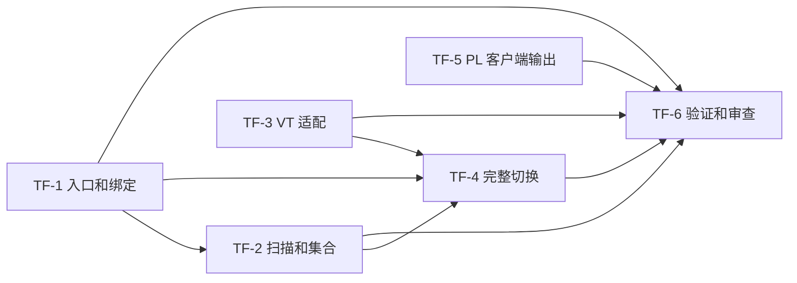

# 表函数框架与虚拟表迁移实施任务图

状态：实现和本地验收完成，最终审查问题已修复。基线：2026-10-17 获取并在交付前复核的 `origin/master`，`a8afc89e9bb3fd4db41cefcb77274a1fe35879cc`。集成分支：`feat/table-functions-schema-free`。生产候选构建为 `40b6a9302`，随后提交仅补充快照测试和交付记录。

规格：[表函数框架](../design/table-functions.md)、[PL 复合值输出](../design/pl-composite-client-output.md)。全部 Q1–Q23 和六项架构复核修订均为实现契约；历史行为只作核查依据。

## 任务图

| Ticket | 交付 | 阻塞于 | 状态 |
| --- | --- | --- | --- |
| [TF-1](https://github.com/oceanbase/seekdb/issues/1519) | 共同注册、FROM 调用及专属语法适配、绑定列和别名、SHOW/DESCRIBE、查询展开及缓存接入 | 无 | 完成；SQL 回归及同名重载单测通过 |
| [TF-2](https://github.com/oceanbase/seekdb/issues/1520) | 统一扫描接入；SQL/PL UNNEST、多输入与记录映射；GENERATOR 执行时参数、关联重扫及资源生命周期 | TF-1 | 完成；集合单测、关联重扫及资源验证通过 |
| [TF-3](https://github.com/oceanbase/seekdb/issues/1521) | 启用 VT 清单、轻量描述符生成、无自身表 schema 的扫描器和工厂适配 | 无 | 完成；143 项列信息与有限扫描对比无新增错误 |
| [TF-4](https://github.com/oceanbase/seekdb/issues/1522) | 系统信息函数接入，视图/SHOW/内部查询切换，移除自身 schema 创建/名字映射/bootstrap 落盘 | TF-1、TF-2、TF-3 | 完成；新实例元数据为 0，视图、目录快照与权限回归通过 |
| [TF-5](https://github.com/oceanbase/seekdb/issues/1523) | 通用结果输出层的 PL 复合值编码，统一文本/二进制及普通/打包输出 | 无 | 完成；14 项编码和真实协议接口测试通过，当前 PL 语言边界见验证记录 |
| [TF-6](https://github.com/oceanbase/seekdb/issues/1524) | 全部功能验收、生产编译、针对性回归、新实例 schema/磁盘对比、PR 审查与问题修复 | TF-1、TF-2、TF-3、TF-4、TF-5 | 完成；release、20 项 C++ 测试、7 项生成测试、6 套 mysqltest 通过；审查无未解决 Blocker/Major |

## 完成标准与分工约定

- TF-1：通用查找不按函数名分派；固定/动态列与 SELECT metadata 一致；查询展开在绑定后成为普通派生表；绑定时读取可变变量使用通用不可缓存标记。语法及发现/描述入口包含有效和错误输入验证。
- TF-2：按规格覆盖空/NULL/不等长输入、记录列、部分别名、冲突、LEFT/CROSS 关联。GENERATOR 默认列名 generator，参数每次调用求值一次。公共扫描不依赖函数自身 ObTableSchema。
- TF-3：清单覆盖构建启用的定义和工厂；输出列取轻量描述，不能合成完整 ObTableSchema；保留真实对象 schema、访问权限、定位以及各扫描器资源生命周期。构建生成的代码必须来自源定义。
- TF-4：每个 VT 能力及消费者有明确去向，合并需要语义证据；不能用临时 schema 或旧表名隐式兜底绕过迁移。新实例不注册、不写入自身 VT 表/列/索引/历史/DDL 元数据，保留视图和真实数据。
- TF-5：同类型复合值跨来源编码一致，保持单列和 SQL 内部类型；覆盖空/NULL/嵌套与协议路径。编码逻辑不放进表函数接口。
- TF-6：以主设计验收矩阵逐项给出运行证据；有未完成能力时不能将任务标记完成或 PR 标记 ready。

实现子代理在独立 worktree/分支提交，合并子代理将完成提交合入集成分支。共享接口先确定再接入，源码清单与模块依赖随代码同步更新；不改变用户其它工作树或演示实例。构建复用本地依赖缓存，生产编译集中在集成分支完成。

## 记录

- 最新 master 基线已获取；此前设计与研究文档随实现分支保存。
- 调研笔记目录：`/data/1/nijia.nj/table-function-implementation-notes/`，供子代理共享，位于仓库之外。
- [规格跟踪 issue](https://github.com/oceanbase/seekdb/issues/1518)；各任务链接见上表；[PR #1525](https://github.com/oceanbase/seekdb/pull/1525)。
- 最新 master 的启用清单：143 个 VT、1664 个输出列、0 个 VT 索引、139 个系统视图。136 个有效手写工厂分支及 7 个生成 provider 覆盖全部 VT；另有 10 个已无定义的旧 ID 分支，不纳入迁移能力清单。
- 设计基线中的 SQLite 生成扫描已在最新 master 改为 LocalStore/Rust 提供方；7 个生成 provider 包含 6 个 LocalStore snapshot cursor 和 1 个 Rust 配置目录，11 个真实本地存储定义必须保留。实现按最新数据源适配，不恢复旧 SQLite 实现。

## 基线运行证据

基线代码为 `a8afc89e9`，二进制版本中的 `81fdb3b26` 仅包含实施文档提交。release 构建通过，依赖和 Cargo 使用本地缓存。独立实例使用 `memory_budget=2G`、`cpu_count=4`、`datafile_size=512M`、`log_disk_size=2G`；不会复用已有演示实例或把半迁移实例当作最终新实例。

按清单的 143 个旧 ID 实测：`__all_table` 143 行、`__all_column` 1664 行、`__all_table_history` 143 行、`__all_column_history` 1664 行、`__all_ddl_operation` 143 行，共 3757 行；143 个旧名称全部可绑定。139 个系统视图仍存在，逐个 `LIMIT 1` 查询有 138 个成功；`V$OB_PX_TARGET_MONITOR` 在未修改的基线即报 4016，需与迁移引入的问题区分。

证据位于共享笔记目录的 `baseline-instance.json`、`baseline-view-execution.json`、`baseline-build-offline.log`；`capture_instance.py` 记录相同口径的元数据、运行时旧名称、schema 分配器及实际文件占用。文件预分配、日志和真实系统存储必须与删除的 VT 元数据分开解释，不能把文件尺寸直接当作 VT 数据量。

实施后的实测记录见[验证记录](./table-functions-validation.md)和[消费者验收](./table-function-consumer-validation.md)。记录区分迁移结果、基线已有问题及当前 PL 运行时边界；本地验收不等同于远端完整 CI 已通过。
